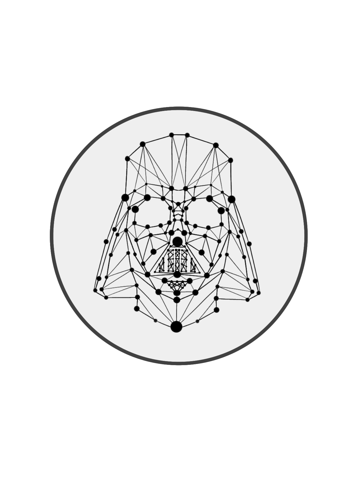

<p align="center">
  
</p>

<h2 align="center">Declarative Recall Through Early Termination for Approximate Nearest Neighbor Search</h2>

<h3 align="center">Manos Chatzakis, Yannis Papakonstantinou, Themis Palpanas<h3>
 
<h4 align="center">⚠️ Please note that the code recently went under heavy refactoring. Please contact us if you notice any issues ⚠️ </h3>

DARTH and DARTH+ enable declarative recall for approximate nearest-neighbor search: specify a target recall, and a learned predictor estimates when to stop each query. 
Their adaptive early termination adjusts to query difficulty and
reduces unnecessary search work.

DARTH+ extends DARTH with more efficient training data collection and
query-dimension-aware prediction features. Its lower-bound variant can also
provide optional probabilistic lower bounds on recall.

## How to run

Build the pipeline from the repository root:

```bash
cmake -S . -B build-native -DCMAKE_BUILD_TYPE=Release \
  -DFAISS_ENABLE_GPU=OFF -DFAISS_ENABLE_PYTHON=OFF \
  -DLIGHTGBM_ROOT="$HOME/lightgbm-install"
cmake --build build-native --target darth_pipeline -j 4
```

Adjust `LIGHTGBM_ROOT` for your installation. If the runtime loader cannot
find LightGBM, add its library directory to `LD_LIBRARY_PATH`:

```bash
export LD_LIBRARY_PATH="$HOME/lightgbm-install/lib${LD_LIBRARY_PATH:+:$LD_LIBRARY_PATH}"
```


For example, run DARTH+ on SIFT100M with HNSW:

```bash
build-native/darth-runners/darth_pipeline \
  --dataset SIFT100M --dataset-dir-prefix /path/to/processed-data \
  --index hnsw --method darth-plus --k 50 \
  --index-filepath /path/to/indexes/sift-hnsw.index \
  --threads 12 --training-threads 12
```

## Datasets

The pipeline reads `.fvecs` vectors and `.ivecs` exact-neighbor
labels.
For example, SIFT100M expects:

```text
DATASET_DIRECTORY/SIFT100M/
  base.100M.fvecs
  learn.1M.fvecs
  validation.10K.fvecs
  query.10K.fvecs
  learn.groundtruth.1M.k1000.ivecs       # optional
  validation.groundtruth.10K.k1000.ivecs # optional
```

See [VectorDataLoader.cpp](common/VectorDataLoader.cpp) for more information.

Dataset sources: [SIFT and GIST](http://corpus-texmex.irisa.fr/),
[DEEP and Text2Image](https://research.yandex.com/blog/benchmarks-for-billion-scale-similarity-search),
and [GloVe](https://nlp.stanford.edu/projects/glove/).


## References
If you use DARTH or DARTH+, please cite:

```bibtex
@article{chatzakis2025darth,
  title={Darth: Declarative recall through early termination for approximate nearest neighbor search},
  author={Chatzakis, Manos and Papakonstantinou, Yannis and Palpanas, Themis},
  journal={Proceedings of the ACM on Management of Data},
  volume={3},
  number={4},
  pages={1--26},
  year={2025},
  publisher={ACM, New York, NY, USA}
}

@article{chatzakis2026darth+,
  title={DARTH+: Approximate Nearest Neighbor Search with Declarative Recall and Quality Guarantees},
  author={Chatzakis, Manos and Papakonstantinou, Yannis and Palpanas, Themis},
  journal={HAL Preprint},
  year={2026}
}

@article{chatzakis2026declarativephd,
  title={Declarative Recall for Approximate Vector Search},
  author={Chatzakis, Manos},
  journal={Proceedings of the VLDB Endowment. ISSN},
  volume={2150},
  pages={8097}
}

@inproceedings{chatzakis2026darth+workshop,
  title={DARTH+: Vector Search with Declarative Recall and Guarantees},
  author={Chatzakis, Manos and Papakonstantinou, Yannis and Palpanas, Themis},
  booktitle={The 2nd Workshop on Vector Databases},
  year={2026},
}
```

## About
This repository includes FAISS code, which remains subject to its original
license. See [LICENSE](LICENSE). For questions, contact
[the authors](mailto:manos.chatzaki@gmail.com).
